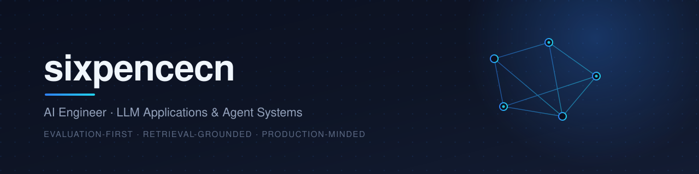

<div align="center">
  
</div>

<br/>

<div align="center">

  <a href="https://github.com/sixpencecn"></a>
  
  

</div>

## Hi, I'm sixpencecn

I build **LLM-powered applications** — agent orchestration, retrieval pipelines, and the
unglamorous tooling that keeps them dependable once real users show up.

I care more about evaluation, failure modes and cost per answer than about demo-day magic.

```python
@pipeline
def answer(question: str) -> str:
    context = retrieve(question, k=8)        # grounding beats guessing
    draft   = synthesize(question, context)
    return verify(draft) or escalate(question)
```

## Focus

- **Agent systems** — tool use, planning loops, and the guardrails that keep them bounded
- **Retrieval that holds up** — chunking, hybrid search, and measuring whether the retrieved context was actually right
- **Evaluation & observability** — offline suites, trace review, and knowing *why* an answer failed

## Toolkit

<p align="left">
  
</p>

## GitHub

<div align="center">

  
  

</div>

## Connect

<div align="center">

  <a href="https://github.com/sixpencecn"></a>
  <a href="https://github.com/sixpencecn/sixpencecn/issues/new"></a>

</div>

<br/>

<p align="center"><sub>Always measuring. Rarely guessing.</sub></p>
